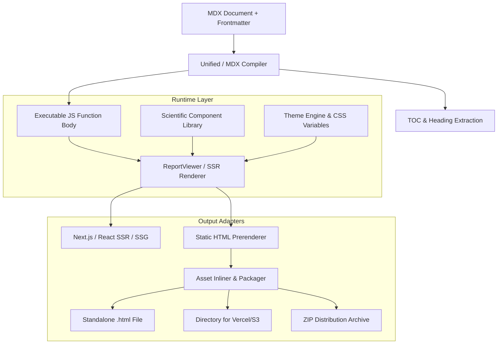

# System Architecture & Design

Inkblot is designed around a strict separation between **MDX compilation**, **component rendering**, and **static bundling**.

---

## Architectural Layers

---

## 1. Unified Compilation Pipeline

When an MDX document enters Inkblot:

1. **Frontmatter Extraction**: `gray-matter` splits YAML metadata (title, date, abstract, theme) from the markdown body.
2. **AST Parsing & TOC Generation**: A custom remark plugin (`remarkExtractToc`) walks the markdown heading nodes (`##`, `###`) and JSX nodes (`<Section>`, `<Subsection>`), extracting a hierarchical Table of Contents with IDs and section numbers.
3. **GFM & Math Plugins**:
   - `remark-gfm`: GitHub Flavored Markdown (autolinks, footnotes, tables).
   - `remark-math` & `rehype-katex`: Parses math syntax (`$...$` and `$$...$$`) into pre-rendered KaTeX HTML.
   - `rehype-slug`: Guarantees deterministic heading anchor IDs.
4. **Function Body Generation**: `@mdx-js/mdx` compiles the AST into an evaluation-ready JavaScript function body.

---

## 2. Server-Rendered Semantic SVG (Zero-JS Fallback)

Rather than embedding heavy client charting libraries (e.g. D3, Plotly, Recharts), Inkblot renders all charts directly as pure semantic SVG markup on the server:

- **Instant First Paint**: The chart is immediately visible and styled even if JavaScript is disabled or delayed.
- **Accessible Data Fallback**: Every `<DotPlot>` and `<XYPlot>` automatically renders a `

Show data table
...
` element directly beneath the graphic containing a formatted semantic `<table>`.
- **Printable**: Renders crisply to PDF or print dialogs without canvas rasterization artifacts.

---

## 3. Micro Client Script (<3KB)

For static HTML outputs, Inkblot avoids shipping an entire React hydration bundle. Instead, it embeds a minified, dependency-free vanilla JavaScript snippet (`INKBLOT_CLIENT_SCRIPT`) that delivers:

1. **Floating Tooltips**: Listens on `.hit[data-tip]` SVG hit zones for hover/focus events, dynamically calculating viewport boundaries to prevent overflow.
2. **Scroll-Synchronized TOC Spy**: An `IntersectionObserver` tracks which section is in view and updates the active styling on the desktop sidebar TOC.
3. **Mobile TOC Auto-Close**: Closes the collapsible mobile `
` menu when a user taps an anchor link.
4. **Interactive Tab Switching**: Toggles `.active` classes on `<Tabs>` button items and panels.

---

## 4. Static Bundling Pipeline (`inkblot build`)

When invoked from the CLI:

- **Standalone Mode**:
  - Compiles MDX via `renderReportToHtml`.
  - Inlines CSS variables, core styles, and KaTeX styles inside `<style>` in `<head>`.
  - Embeds the micro client script inside `<script>` before `</body>`.
  - Generates a single, portable HTML file requiring 0 external assets.
- **Directory Mode**:
  - Emits `index.html`, `assets/style.css`, and `assets/inkblot.js`.
  - Configured with relative paths so the directory can be hosted at any subpath on Vercel, S3, Netlify, or Cloudflare Pages without a web server or build step.
- **ZIP Packaging**:
  - Uses `archiver` to package the directory or standalone file into a compressed `.zip` archive.
