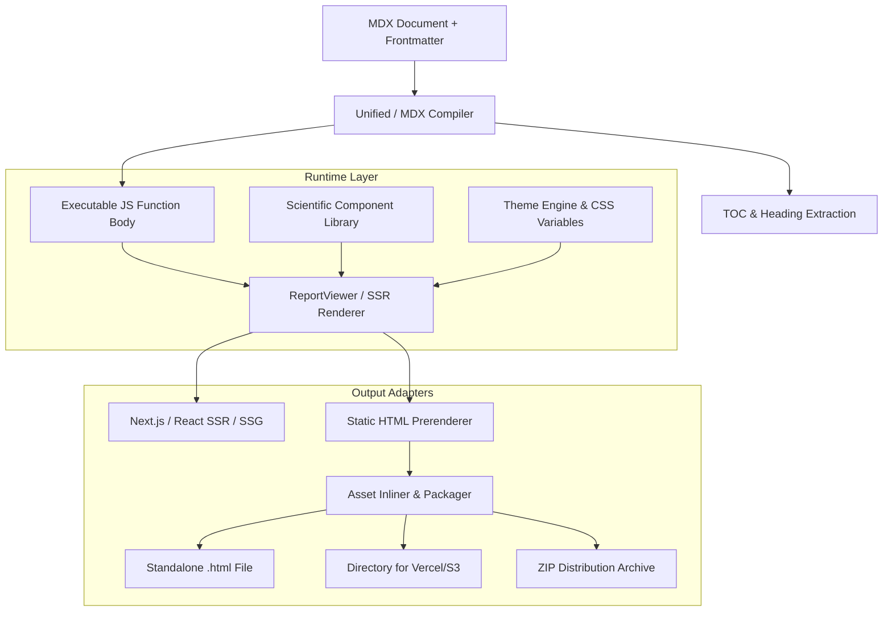

# System Architecture & Design

Inkblot is designed around a strict separation between **MDX compilation**, **component rendering**, and **static bundling**.

---

## Architectural Layers

---

## 1. Unified Compilation Pipeline

When an MDX document enters Inkblot:

1. **Frontmatter Extraction**: `gray-matter` splits YAML metadata (title, date, abstract, theme) from the markdown body.
2. **AST Parsing & TOC Generation**: A custom remark plugin (`remarkExtractToc`) walks the markdown heading nodes (`##`, `###`) and JSX nodes (`<Section>`, `<Subsection>`), extracting a hierarchical Table of Contents with IDs and section numbers.
3. **GFM & Math Plugins**:
   - `remark-gfm`: GitHub Flavored Markdown (autolinks, footnotes, tables).
   - `remark-math` & `rehype-katex`: Parses math syntax (`$...$` and `$$...$$`) into pre-rendered KaTeX HTML.
   - `rehype-slug`: Guarantees deterministic heading anchor IDs.
4. **Function Body Generation**: `@mdx-js/mdx` compiles the AST into an evaluation-ready JavaScript function body.

---

## 2. Server-Rendered Semantic SVG (Zero-JS Fallback)

Rather than embedding heavy client charting libraries (e.g. D3, Plotly, Recharts), Inkblot renders all charts directly as pure semantic SVG markup on the server:

- **Instant First Paint**: The chart is immediately visible and styled even if JavaScript is disabled or delayed.
- **Accessible Data Fallback**: Every `<DotPlot>` and `<XYPlot>` automatically renders a `

Show data table
...
` element directly beneath the graphic containing a formatted semantic `<table>`.
- **Printable**: Renders crisply to PDF or print dialogs without canvas rasterization artifacts.

---

## 3. Static documents with hydrated controls

The document and semantic SVG charts remain server-rendered. Tabs, disclosures, search, mobile navigation, and appearance controls use the same shadcn/Radix components in generated HTML and React hosts.

Generated HTML serializes control props and static content slots into independently hydrated regions. Each region is rendered with `renderToString` and a stable identifier prefix. The surrounding document uses static rendering. Nested tab content stays mounted so nested controls retain their state. The browser runtime contains React and the controls; it does not compile or evaluate the report's MDX.

The separate scientific enhancement script handles SVG tooltips, section tracking, and 3D visualization. It no longer implements tabs, search, appearance menus, or mobile navigation. Scientific enhancements also initialize when hosted React reports mount.

Standalone HTML embeds the browser bundle. Directory and site exports serve a shared bundle from their assets directory. `clientScript: false` produces readable static output with all tab content exposed and no script tags. `renderReportToHtml(..., { standalone: false })` returns the runtime as `result.script` for HTML embedding hosts.

React and Next.js hosts use the explicit `inkblot/client` boundary and their own React runtime. The Next adapter keeps compilation and scientific server rendering outside that boundary. Published CSS is compiled and scoped during Inkblot's build, so hosts need no Tailwind build step.

The pre-migration site runtime at commit `2b937ca` was approximately 24 KB raw / 6 KB gzip. The migrated shared browser bundle is approximately 455 KB raw / 144 KB gzip, including React, Radix, command search, and all controls. The build prints current raw and gzip sizes. This increase replaces the separate hand-written interactions with the selected component library; MDX prose is still static.

---

## 4. Static Bundling Pipeline (`inkblot build`)

When invoked from the CLI:

- **Standalone Mode**:
  - Compiles MDX via `renderReportToHtml`.
  - Inlines CSS variables, core styles, and KaTeX styles inside `<style>` in `<head>`.
  - Embeds the React control and scientific enhancement bundle inside `<script>` before `</body>`.
  - Generates a single, portable HTML file with no external JavaScript dependencies for UI controls. Reading fonts, KaTeX fonts, and the optional Three.js renderer can still use external resources.
- **Directory Mode**:
  - Emits `index.html`, `assets/style.css`, and `assets/inkblot.js`.
  - Configured with relative paths so the directory can be hosted at any subpath on Vercel, S3, Netlify, or Cloudflare Pages without a web server or build step.
- **ZIP Packaging**:
  - Uses `archiver` to package the directory or standalone file into a compressed `.zip` archive.

## Maintaining the component preset

`components.json` selects `radix-luma`; `shadcn.preset.json` records the requested preset and CLI version. The component source is owned by Inkblot after import. Local adaptations keep portals inside their report container, use language motion values, limit button transitions to colors, and synchronize the search combobox's active descendant when asynchronous results arrive. Review those adaptations before overwriting components with a future generator run.
